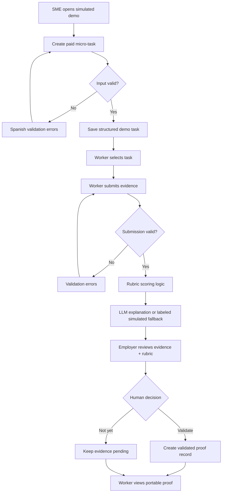
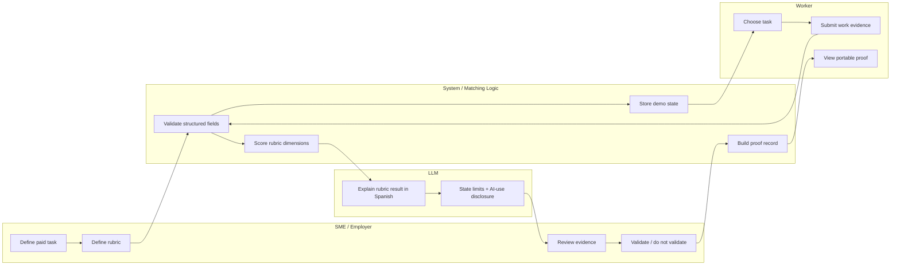

# BUSINESS BENDING · WEEK 9 — PACKET

**Student:** Diego Gil  
**Role:** MONEY  
**Product:** Escudo Talento — Prueba Pagada  
**Declared vacuum:** MICRO-EXPERIENCE  
**Market:** Mexican SMEs and historyless / displaced workers  
**Product language:** Spanish (Mexico)  
**Packet language:** English

> **Packet-before-code rule:** This document defines the slice before implementation. The mockup is generated before code and remains planning evidence.

## 1. Problem in my words

Mexico's first rung is breaking from both sides. Young workers are asked for experience before anyone gives them a first credible chance to earn it, while AI increasingly performs the routine tasks that historically created entry-level experience. Informal work can contain real skill without producing portable proof that a formal employer trusts.

From the MONEY lens, this is duplicated economic waste. Workers spend time, unpaid labor, credential fees, and delayed income manufacturing a signal. Employers then spend again on screening, interviews, take-home tests, onboarding, and bad-hire risk.

**The slice:** Escudo Talento lets a Mexican SME define a small, paid, bounded real-work task. A worker completes it and leaves with portable evidence. AI helps evaluate the submission against a transparent rubric, but the employer—not the model—validates the result.

The economic hypothesis is not “10x cheaper hiring” as a proven fact. The **10:1 opportunity to test** is whether months of waiting for credible first experience can be compressed into tens of hours of paid, verifiable work while turning part of screening cost into productive output.

## 2. Exact user

### Primary user — Mexican SME owner / manager
- Runs a small business without a dedicated recruiting team.
- Has useful bounded work that is postponed, manual, or assigned ad hoc.
- Wants a low-risk way to test talent without committing to a full hire.
- Needs plain Spanish, predictable scope, cost, and review criteria.

### Secondary user — first-rung worker
- Roughly 18–30 with little/no trusted formal work history, **or** displaced and needing new proof.
- Needs paid experience rather than another unpaid credential.
- May have informal capability that is difficult to demonstrate.
- Needs evidence that remains useful beyond one employer.

All demo names, companies, submissions, and payment states are fictional and visibly labeled as simulated. No real personal data is used.

## 3. Success definition — before the module closes, X works

Before the module closes, a user can open the live URL and complete this end-to-end slice:

1. View a Spanish dashboard containing **simulated demo data**.
2. An SME can create a paid micro-task with title, scope, estimated hours, MXN payment, deadline, and rubric.
3. Every field validates; malformed, empty, oversized, or unsafe input is rejected.
4. A synthetic worker can select a task and submit work evidence.
5. The app stores structured task, rubric, submission, and evaluation data locally for the demo; it does **not** pretend this is production persistence.
6. Deterministic matching/scoring logic compares evidence with the disclosed rubric.
7. An LLM may produce a Spanish explanation; without an API key, a deterministic fallback works and is labeled **“Evaluación simulada.”**
8. The SME sees rubric evidence and chooses **Validar evidencia** or **No validar todavía**.
9. AI never makes a hiring/rejection decision.
10. The worker-facing proof record shows task, paid hours, rubric dimensions, employer validation state, and AI-use disclosure.
11. The interface states that micro-experience is paid work and cannot substitute indefinitely for an entry-level role.
12. Tests and production build pass and the app deploys to Vercel.

## 4. Image-generated mockup

Planning mockup generated before implementation:

`assets/mockup-escudo-talento.png`

The visual target is a Spanish-first responsive web application with **Inicio**, **Crear micro-tarea**, **Entregar evidencia**, **Evaluación**, and **Prueba verificable**. Payment, hours, scope, rubric, and validation state stay visible.

## 5. Feature flow

## 6. Actor swimlane

**Human boundary:** the LLM can explain evidence; it cannot hire, reject, globally rank people, or validate proof for the employer.

## 7. Benchmark line

**Best existing solution on Earth:** **Parker Dewey Micro-Internships** — short, paid professional projects that let organizations get real work done while candidates build experience and employers evaluate talent.

**Mine differs/localizes by:** Escudo Talento narrows the model to a Spanish-first Mexican SME workflow with MXN-denominated paid tasks, simple task scoping, explicit AI-assisted rubric review, portable proof, and a shadow rule against endless micro-gig substitution.

Supporting patterns: **Riipen** shows structured employer projects/work-integrated learning; **Forage** shows scalable employer-designed simulations, but Escudo Talento deliberately prefers paid real work over simulation as the strongest proof layer.

## 8. Long view — 3 years

If this slice works, Escudo Talento becomes a trusted micro-experience layer for Mexico where SMEs publish bounded paid projects and workers accumulate portable, employer-validated evidence of capability. The platform maps verified evidence into transferable skills and next-rung opportunities without becoming a generic job board or CV marketplace. In three years it can integrate universities, training providers, employers, and formalization pathways while preserving the load-bearing rule that proof belongs to the worker and AI assists rather than decides.

## 9. Scope cut — what I am NOT building

- No CV builder.
- No generic job board or infinite listings feed.
- No full freelance marketplace.
- No real payment processing; amount/status is simulated and labeled.
- No production personal-data persistence in the demo.
- No automated hiring/rejection decision.
- No opaque “employability score.”
- No employee surveillance or biometrics.
- No advanced recommendation engine.
- No native mobile app.
- No claim that completing a micro-task guarantees employment.

## 10. Shadow clause

**Specific harm:** Micro-experience can become a new precarity machine: workers perform endless tiny auditions, employers receive cheap labor without creating a ladder, and algorithmic scores follow people without context.

**Design decisions:**
1. Every task is visibly **paid** and has bounded hours, deliverable, and end state.
2. The UI warns that repeated micro-work is not a substitute for an entry-level role.
3. Proof is portable and belongs to the worker.
4. AI evaluates evidence only against the disclosed task rubric; there is no global worker score.
5. AI cannot make the employer's validation or hiring decision.
6. Worker AI assistance can be disclosed rather than treated as hidden cheating.
7. A future product exposes project-to-longer-opportunity conversion instead of optimizing only for gig volume.

## 11. Architecture + Dragon Stack

| Layer | Tool / approach | Purpose |
|---|---|---|
| Frontend | Next.js + React + Tailwind CSS | Responsive Spanish UI |
| Structured data | Typed JSON / browser-local demo state | Tasks, rubrics, submissions, evaluations, proof |
| Matching/scoring | Deterministic TypeScript rubric logic | Testable comparison against disclosed rubric |
| LLM | OpenAI API, optional/server-side only | Spanish explanation of rubric evidence |
| Fallback | Deterministic simulated evaluator | Demo works without key; visibly labeled |
| Validation | Zod or equivalent | Length, enum, number, date, content limits |
| Tests | Vitest + Testing Library | Logic, validation, copy, shadow constraints |
| Deployment | Vercel | Live URL |
| Version control | Git + GitHub | Packet-before-code evidence + commit history |

**Dragon Stack:** LLM + structured/verified data + matching/scoring logic.

“Verified” in this slice means employer validation of a bounded evidence record—not cryptographic identity verification or proof of a real person's identity.

## 12. Security floor

1. **No secrets in code/repo.** `OPENAI_API_KEY` optional and server-side only via Vercel env vars.
2. **No real personal data** in demo/seeds. All identities/businesses are synthetic and labeled.
3. **No fake auth.** Demo uses browser-local synthetic state. Real personal data or durable multi-user persistence requires Supabase Google Auth first.
4. **RLS before real user tables.** Future Supabase user-data tables require owner-scoped Row Level Security before use.
5. **Validate every form.** Explicit limits/types for title, description, hours, MXN, rubric, deadline, evidence.
6. **Bound LLM I/O.** Only validated task/rubric/evidence reaches the server prompt; output is untrusted explanatory text.
7. **Human decision remains explicit.** Employer validation is separate from AI analysis.

## 13. Data model

### Task
`id`, `title`, `description`, `hoursMin`, `hoursMax`, `paymentMxn`, `deadline`, `skills[]`, `rubric[]`, `status`, `isSimulated`

### Submission
`id`, `taskId`, `syntheticWorkerName`, `evidenceSummary`, `evidenceItems[]`, `aiUseDisclosure`, `submittedAt`, `isSimulated`

### Evaluation
`taskId`, `submissionId`, `dimensionResults[]`, `overallSummary`, `mode: "live-ai" | "simulated"`, `humanValidation: "pending" | "validated" | "not-yet"`

### ProofRecord
`taskTitle`, `paidHours`, `paymentMxn`, `skillsDemonstrated[]`, `rubricEvidence[]`, `humanValidation`, `aiUseDisclosure`, `isSimulated`

## 14. Test plan

### Mechanical pass
- Create a valid task and verify it appears.
- Reject empty/oversized title/description.
- Reject negative/zero payment and impossible hour ranges.
- Reject invalid/past deadline where appropriate.
- Submit valid synthetic evidence.
- Reject oversized evidence and invalid task ID.
- Verify only disclosed rubric dimensions are evaluated.
- Verify fallback says **Evaluación simulada** without an API key.
- Verify AI output cannot directly set `humanValidation`.
- Validate evidence as employer and confirm proof record updates.
- Confirm intended browser-local demo persistence.
- Run tests + production build.
- Find one real bug, document it in `docs/DECISIONS.md`, fix, commit, push, redeploy.

### Persona pass
Synthetic persona: **Mariana, 23**, recent graduate from a public university in Estado de México. She has helped in her family's informal business and can use WhatsApp, spreadsheets, Canva, and AI tools, but has no formal work history. She hates corporate jargon and wants immediate answers to: **Is this real work? How much does it pay? What exactly do I deliver? Does this proof help me somewhere else?**

Walk her through screenshots in order: home → task → payment/scope → evidence submission → evaluation → employer validation → portable proof. Log every hesitation in `docs/PERSONA.md`. Fix the worst confusion, add a regression test when practical, commit, push, redeploy.

## 15. Load-bearing walls

The implementation is wrong if any becomes false:
- Not a CV builder or job board.
- Unit of value = **paid, bounded real work**.
- Demo data synthetic and clearly labeled.
- AI assists rubric explanation; never acts as hiring authority.
- Employer explicitly validates evidence.
- No global worker score.
- Proof is portable to the worker.
- No secret ships to browser/repo.
- No real personal data stored without auth + RLS.
- Spanish UI understandable without HR/AI expertise.
- Deterministic simulated fallback works.
- Shadow clause appears in product behavior, not only docs.

## 16. Commit + deploy plan

1. `docs: establish week 9 packet before code`
2. `feat: establish Spanish micro-experience shell`
3. `feat: add paid task creation and structured validation`
4. `feat: add evidence submission and rubric evaluation`
5. `feat: add human validation and portable proof`
6. `test: cover money logic security floor and shadow constraints`
7. `fix: resolve mechanical test bug`
8. `fix: address persona-test confusion`

**Deploy #1:** complete initial slice.  
**Deploy #2:** after mechanical bug fix.  
**Final deploy:** after persona fix.

## 17. Session Close

At every build-session end:
- Update `docs/DECISIONS.md`.
- Record bug/test result and unresolved risk.
- Write next session's first move.
- Run tests + production build.
- Commit and push.

**First implementation move after this packet is committed:** create the Spanish app shell and synthetic demo state. Do not add production persistence before auth/RLS.
